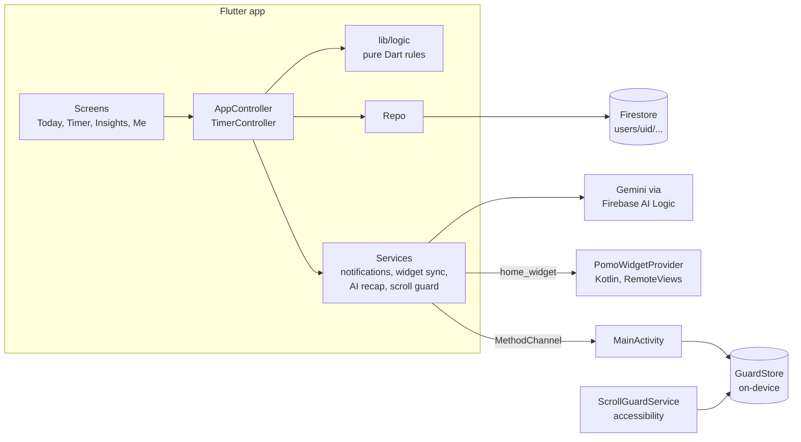

# TaskPomo

**Duolingo-style streaks for anything you practise, built on pomodoro sessions.**
Give a task a daily target and the days it's due, work on it in focus
sessions, and keep a streak per task. Points you earn buy streak freezes,
and can also be spent as minutes on the apps you're trying to use less.


I built TaskPomo for my own habits, and use it daily on my phone. It started
as a personal tool and is now being prepared for Google Play.

## Highlights

- **Fair streaks, per task.** Each task keeps its own streak, judged only on
  the days it's due. Points scale with how long a task is, and freezes cost
  more for short tasks than long ones, so neither is a loophole.
- **Private by design.** The homescreen widget, notifications and lock screen
  never show task names, only minutes, counts and streaks. The app-limit
  guard sees which app is in front, never what's on screen, and app names
  stay on the phone.
- **Points as a scrolling budget.** One point buys one minute on the apps you
  choose to limit (Instagram, YouTube…). An Android accessibility service
  counts the time and covers the app with a pause page when the points run
  out, with a live countdown in the notification shade.
- **Honest sessions.** During a focus session, time in other apps is noted.
  Social apps and games never count; anything ambiguous (YouTube during
  music practice could be a tutorial or Shorts) is asked about once, and the
  answer can be remembered per task.
- **Insights for data people.** Hand-drawn charts (CustomPainter): the year
  in squares, focus by weekday and hour, session-length histogram, target vs
  actual, streak runs, habits that travel together. Every mark can be tapped
  to inspect. CSV export of the full ledger, with a README describing every
  column, ready for analysis or an AI agent.
- **Grounded AI recaps.** A weekly note, a monthly recap and a yearly
  Wrapped, written by Gemini through Firebase AI Logic. The prompts carry
  exact numbers and your own session notes, with rules against guessing what
  you did from a task's name.
- **A homescreen widget that fills its space.** Native RemoteViews in Kotlin.
  Widgets can't use custom fonts, so the serif numerals are drawn into
  bitmaps. The paper background yellows through the day while work is left.

## Engineering notes

- **Rules are pure Dart and tested.** Streaks, points, milestones, freezes,
  paper aging, analytics, CSV export, the scroll allowance and the session
  check live in `lib/logic/`, with no Flutter or Firebase imports, and are
  covered by unit tests.
- **Time comes from timestamps, not ticking.** A session stores when each
  segment started, so the timer stays right if the app is killed or the
  phone sleeps. Time left out of a session is kept apart from the timer's raw
  total, so pausing never subtracts it twice.
- **Offline first.** Firestore with offline persistence; every user's data
  sits under `users/{uid}` behind owner-only security rules.
- **Dart and Kotlin share one source of truth.** The accessibility service
  counts usage in on-device storage. The app pays for it in points the next
  time it runs, and tells the service what the remaining points buy. Neither
  side has to be running for the other to stay correct.
- **Store readiness.** A prominent in-app disclosure and consent before the
  accessibility setup, the service declared as not an accessibility tool,
  account deletion in the app and on the web
  ([taskpomo-d5f21f.web.app/delete-account](https://taskpomo-d5f21f.web.app/delete-account)),
  App Check (Play Integrity) for Play installs, and upload-key signing.

## Architecture



## How it works

| | |
|---|---|
| **Task** | Name, icon, daily target (5 minutes to hours) and schedule (daily, weekdays, weekends or custom days). |
| **Sessions** | Starting a task starts a pomodoro (25 minutes by default, or the task's target if shorter). Keep going through as many rounds as you like, pause, or stop. All of a day's sessions add up toward the target. |
| **Streak** | Per task, counting due days that hit their target. Days that aren't due never break it; missing one task never touches the others. |
| **Points** | About 1 point per 3 minutes of a task's daily target (15 min → 5, 1 h → 20, 2 h → 40). Clean-streak milestones (10, 20, 50, 100… days) pay a modest multiple of the task's daily points. |
| **Freezes** | Per task and per day. A day costs 5 days of that task's points for tasks of 5 minutes or less, sliding to 3 days' worth at 2 hours or more. Freeze one task from its menu, or several for a trip. Optional auto-freeze spends points on a missed day. |
| **Scroll minutes** | 1 point = 1 minute across all limited apps combined. A reserve for freezes can't be scrolled away. At zero the apps pause; once a day there are 5 grace minutes, repaid from future points. |
| **Session check** | With the guard on, apps opened while a session's timer runs are judged by their declared category: social apps, games and limited apps never count; video, browsers and anything else are asked about after the session. |
| **Streak moment** | Completing a day opens a full-screen page where the streak number rolls over, the dial moves toward the next bonus and today's square fills. |
| **Look** | "Ledger": warm paper, Instrument Serif numerals with Geist and Geist Mono, hairline rules and one rust accent. Always light, no emoji. |

The constants behind these rules are at the top of `lib/logic/streaks.dart`
and `lib/logic/scroll.dart`.

## Project layout

```
lib/
  logic/      rules: streaks, points, analytics, CSV export, scroll allowance, session check (pure Dart)
  models/     Task, DayLog, Session, Profile, LedgerEntry
  data/       repo.dart: every Firestore read and write
  state/      AppController (live data, daily streak check), TimerController (sessions)
  services/   notifications, widget sync, Gemini recaps, scroll guard bridge, account, App Check
  screens/    Today, Timer, Task, Insights, Monthly recap, Wrapped, Me, Streak moment
  ui/         Ledger components, chart kit, icon set
android/app/src/main/kotlin/…
  PomoWidgetProvider.kt   homescreen widget
  ScrollGuardService.kt   accessibility service: counting, pause page, live countdown
  GuardStore.kt           on-device state shared by the service and the app
  MainActivity.kt         MethodChannel bridge
site/                     static pages on Firebase Hosting (account deletion)
test/                     unit tests for the rules and the timer
```

## Tech stack

| Area | Choice |
|---|---|
| App | Flutter, Dart 3, provider |
| Android | Kotlin: RemoteViews widget, AccessibilityService, overlay window, MethodChannel |
| Backend | Firebase Authentication (Google), Cloud Firestore, Hosting, App Check |
| AI | Gemini through Firebase AI Logic (`firebase_ai`), JSON responses |
| Other | flutter_local_notifications, home_widget, share_plus |
| Type and icons | Instrument Serif, Geist, Geist Mono (SIL OFL), Phosphor (MIT), bundled |

## Running it

You need Flutter (stable), the Android SDK, and a Firebase project of your
own.

1. In the [Firebase console](https://console.firebase.google.com), create a
   project and enable **Authentication → Google**, **Firestore**, and
   **AI Logic** (Gemini Developer API).
2. Connect the app and deploy the rules:
   ```
   dart pub global activate flutterfire_cli
   flutterfire configure --platforms=android
   firebase use --add
   firebase deploy --only firestore
   ```
3. Add your debug key's SHA-1 to the Android app in Firebase
   (`cd android && ./gradlew signingReport`).
4. Run on a phone with USB debugging on:
   ```
   flutter run
   ```

Release builds are signed with the key described in `android/key.properties`
(not in the repo). Without it they fall back to the debug key.

**Widget:** long-press the homescreen → Widgets → TaskPomo.
**Scroll minutes:** Me → Scroll minutes → Set up, then switch on
*TaskPomo scroll minutes* under Accessibility.

## Tests

```
flutter test
```

42 tests cover streaks and missed days, milestones and bonuses, points and
freeze costs, the week strip and paper aging, insights and analytics, the
recap's input, CSV export, the scroll allowance, the session check rules, and
the timer's handling of time spent in other apps.
